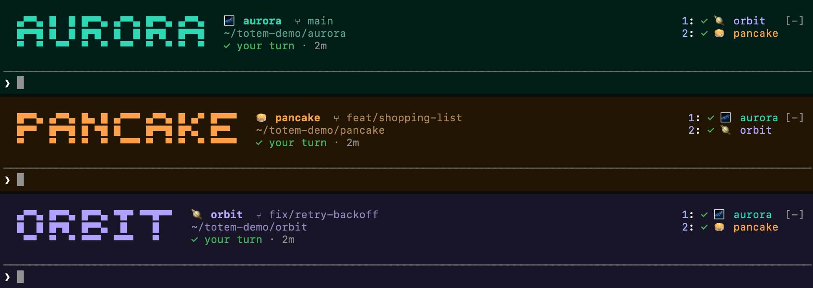
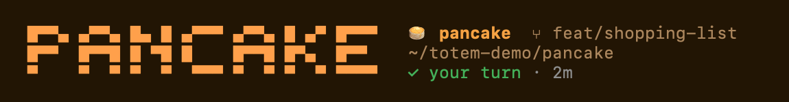
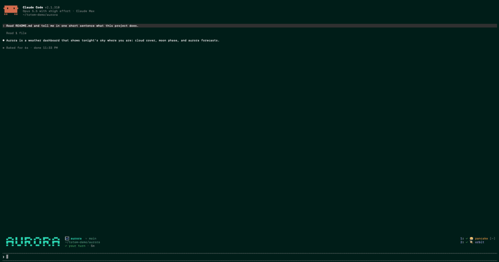
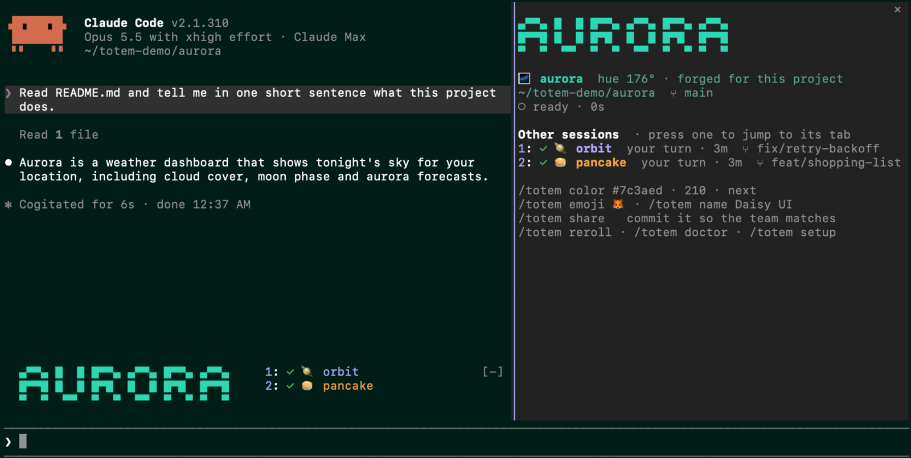

# totem

Know which world you're in. Every Claude Code session wears its project's totem: the whole terminal takes the project's color, its name stands above the prompt in pixel letters, the tab says which project it is, and a radar shows your other sessions, one press away.



## Why

Run four Claude Code sessions in four tabs and every tab reads `…ode • claude --resume`. To find out where you are you squint at the window title or the status line, both small, both the same gray in every project.

totem gives each project an identity you recognize before you read anything:

- **The terminal takes the project's color.** The background of the whole tab shifts to the project's hue while the session runs, and goes back when it ends. You know which project you are in from the corner of your eye.
- **The name, big.** Above the prompt, the project's name in 3-row pixel letters, with its emoji, branch, path and what Claude is doing.
- **Tabs that say something.** The tab title becomes `🌼 daisyui ✓`: emoji, project, and a mark for its state (`◐` working, `●` needs you, `✓` your turn).
- **A radar of your other sessions.** On the right of the band: every other live session, the one that needs you first. Click one (or press its number after `ctrl+x tab`) and its tab comes to the front.
- **Nudges.** When another session hits a permission prompt, or finishes a turn that took more than 30 seconds, the session you are looking at tells you so.





## The smart part

- **Claude picks the totem.** The first time a project opens, a small model reads its folder name and the start of its README and picks an emoji and a hue that fit. daisyUI got 🌼 in yellow; an eSIM platform got 📶; a job scheduler called orbit got 🪐. The answer is saved, so it is asked once per project, ever.
- **No two open projects look alike.** Hues are chosen in OKLCH, so every tint has the same perceived darkness and only the hue changes. A new project's hue keeps 40° clear of every session you have open and 20° clear of projects you used in the last two weeks.
- **Worktrees stay in the family.** A git worktree shares its repository's totem and shows its branch.
- **Teams can share one.** `/totem share` writes `.claude/totem.json` into the repo. Commit it and everyone on the team who runs totem sees the same color and emoji for that repo.

## Install

At the prompt of a Claude Code session in a terminal:

```
/plugin install totem --marketplace Binary-ly/claude-totem
```

Answer `y` to add the marketplace, then pick a scope (user scope runs it in every project). From a shell:

```
claude plugin install totem --marketplace Binary-ly/claude-totem
```

In the desktop app, where `/plugin` does not run: click + next to the prompt box, then Plugins, Add marketplace with `Binary-ly/claude-totem`, then Add plugin.

totem is a Claude Code mod built on the function-hooks plugin API, which is early access. It needs Claude Code 2.1.310 or newer, and the API may move between releases.

### Recommended: let the tab keep the project's name

Claude Code writes its own tab title while it works (a spinner and the task summary), and it decides that once, at launch. Run this once:

```
/totem setup
```

It adds `"CLAUDE_CODE_DISABLE_TERMINAL_TITLE": "1"` to the `env` block of `~/.claude/settings.json`. Restart your sessions and every tab keeps its project's name the whole time. Without it, totem puts the name back whenever Claude stops, so the tab shows the task while Claude works and the project between turns.

**Terminal.app:** its default profile appends the process name and its arguments to every tab, which is what pushes the useful part off narrow tabs. Open Terminal → Settings → Profiles → (your profile) → Tab, and uncheck **Active process name** and **Arguments**. `/totem doctor` tells you whether your profile does this.

## Commands

| Command | What it does |
| --- | --- |
| `/totem` | Opens the pane: this project's totem, and every other live session, each a button that jumps to its tab |
| `/totem color #7c3aed` | Sets the color from hex, `210` sets a hue, `next` moves to the next hue clear of your other projects |
| `/totem emoji 🦊` | Sets the emoji (one that is a single character) |
| `/totem name Daisy UI` | Sets the name the band spells |
| `/totem reroll` | Asks for a new emoji and hue |
| `/totem share` | Writes `.claude/totem.json` so the team matches |
| `/totem jump orbit` | Brings that session's tab to the front |
| `/totem doctor` | Checks the terminal, the tab title setup and the radar |
| `/totem setup` | Turns Claude Code's own tab titles off (see above) |

Your own picks win over a team file on your machine.



## Options

Set them in `/config` under totem:

| Option | Default | |
| --- | --- | --- |
| `band` | `big` | `big`: pixel letters. `bar`: one colored line. `off`: no band |
| `tint` | on | Wash the terminal background in the project's color |
| `title` | on | Name the tab after the project |
| `motion` | `full` | `full`: the name sweeps in on arrival, and sweeps once with a swell of the background when Claude hands you the turn. `calm`: color fades only. `off`: nothing moves |
| `ai` | on | Let a small model pick the emoji and hue. Off: picked from a hash of the path |
| `nudges` | on | Toasts when another session needs you or finishes a long turn |

## Team file

`.claude/totem.json` in a repository:

```json
{ "name": "daisyUI", "emoji": "🌼", "color": "#d4a72c" }
```

Any field can be left out. The color sets the hue and how much color the palette carries: a gray gives a neutral totem.

## Terminals

The tint is OSC 11 and the title is OSC 0, both written straight to the session's tty, so they work wherever those sequences do. Jumping to another tab needs the terminal's own scripting.

| Terminal | Tint | Tab title | Jump | |
| --- | --- | --- | --- | --- |
| Terminal.app | yes | yes | yes | tested |
| iTerm2 | yes | yes | AppleScript | jump untested |
| Ghostty, Alacritty, foot, GNOME Terminal | yes | yes | no | untested |
| WezTerm | yes | yes | `wezterm cli activate-pane` | untested |
| kitty | yes | yes | `kitty @ focus-window` (needs `allow_remote_control`) | untested |
| tmux | ? | ? | `tmux switch-client` | untested |
| Windows | no | no | no | no `sh`: the band and radar still work |

The band and the radar are drawn by Claude Code itself, so they work everywhere it runs; the pixel letters are terminal-only, and the desktop app draws the one-line bar. If you try one of the untested rows, an issue saying what happened is very welcome.

## How it works

```
hooks/
  register.tsx   wiring: session start and end, turn states, commands, the band and the pane
  identity.ts    who a project is: team file, your own pick, or a new totem from the model
  color.ts       OKLCH palettes, hue spacing, hashing
  font.ts        the 5-pixel font, drawn with half blocks into Raster cells
  terminal.ts    finding the tty, OSC writes, AppleScript and CLI jumps
  radar.ts       the live-session files and their order
  draw.tsx       the band (big and bar) and the pane
types/index.d.ts the state contract
tests/           claude plugin test
```

totem keeps its files in `~/.claude/totem/`: `projects/` holds one small JSON per project (its emoji, hue and name), and `live/` one file per running session, refreshed every 5 seconds and removed when the session ends. That folder is how sessions see each other; nothing leaves your machine for it.

The one network call is the totem pick: the first time a project opens, the folder name, the description in `package.json` or `composer.json` and the first 700 characters of the README go to a small model through your own Claude Code session. Turn `ai` off to skip it.

## Development

```
claude --plugin-dir .          # run it from this folder; saves hot-reload
claude plugin test .           # the tests in tests/
claude plugin validate .       # what the engine will load, and what it would refuse
```

`TOTEM_HOME=/some/folder claude --plugin-dir .` gives a session its own totems and radar, so test sessions only see each other and never your real ones. If you also have totem installed, add `--settings '{"enabledPlugins":{"totem@claude-totem":false}}'` so only the working copy runs.

Once a session has loaded the folder, `.claude-plugin/types/` holds this build's API declarations and `tsc -p .` type-checks the mod. See [CONTRIBUTING.md](CONTRIBUTING.md) for where things live and what would help most.

## License

MIT

## Trademarks

Claude and Claude Code are trademarks of Anthropic, PBC. totem is an independent open-source project by [Binary](https://binary.ly) and is not affiliated with, endorsed by, or sponsored by Anthropic.
